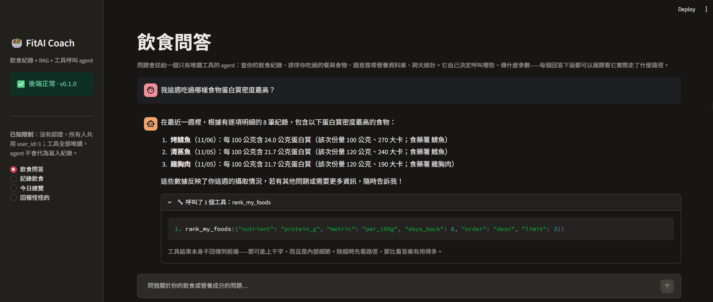
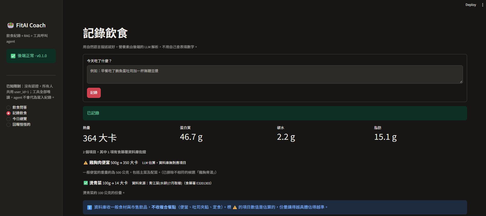

# FitAI Coach

用自然語言記錄飲食、用 AI 教練回答飲食問題的後端服務。

不只是「RAG 套 LLM」——重點放在**怎麼知道它有沒有答對**：軌跡評估、LLM-as-Judge 校準。

---

## 快速開始

需要 Docker、以及一把 OpenAI API key。

```bash
git clone <repo> && cd FitAI

# 1. 設定環境變數（至少要填 OPENAI_API_KEY）
cp backend/.env.example backend/.env

# 2. 啟動（首次會 build，約 2 分鐘）
docker compose up -d --build

# 3. 建立資料表、開發用使用者、基準 prompt
docker compose exec api python -m scripts.init_db

# 4. 種測試用的飲食紀錄（14 天、36 筆，其中 6 餐有逐項明細）
docker compose exec api python -m scripts.seed_dev_data

# 5. 灌營養資料庫（2213 筆，約 1 分鐘、約 0.003 美元）
docker compose exec api python -m app.rag.ingest
```

打開 <http://localhost:8501> 是**介面**，<http://localhost:8000/docs> 是 **API 文件**。

```bash
curl -X POST http://localhost:8000/chat \
  -H 'Content-Type: application/json' \
  -d '{"question": "我今天熱量還剩多少？可以吃什麼點心？"}'
```

> **第 5 步刻意不自動執行。** 它要呼叫 OpenAI 的 embedding API，會產生費用。
> 自動跑的話任何人 `docker compose up` 一次都會花錢，所以設計成明確的一個指令。

停止服務用 `docker compose down`；加 `-v` 會連同資料庫一起刪除，
那表示 2213 筆 embedding 要重灌（要再花一次錢和時間）。

---

## 畫面

前端是 Streamlit（四頁：問答／記錄／今日／問題回報）。
它刻意做得很薄——沒有任何業務邏輯，連加總都是後端算好的，
理由見[測試分兩層](#測試分兩層)那一節。

### 問答：工具路徑是攤開來的



每個回答下面都可以展開**這次呼叫了哪些工具、傳了什麼參數**。
這一塊是刻意做的：一般的聊天介面只給你答案，而答案通順跟答案正確是兩件事。
路徑攤開來之後，「答對了但走錯路」這種情況才看得見——
那是 agent 最常見也最不容易發現的失敗（見 [pitfalls #28](docs/pitfalls.md)）。

### 記錄：可靠的數字跟猜測長得不一樣



✅ 表示數值來自食藥署資料庫（附編號可以自己查），
⚠️ 表示那是 LLM 估的。便當、吐司夾餡這類複合餐點資料庫沒有收，
只能估——而估算值跟查證值用一樣的字體顯示，使用者就不知道哪一項需要核對。

### Eval：改完之後有沒有弄壞別的

```text
[personal_ranking_protein_density]  type=personal
Q: 我吃過什麼蛋白質密度最高的食物？
路徑（2 輪）: rank_my_foods
------------------------------------------------------------------------------
在最近七天的飲食紀錄中（共 18 筆紀錄，當中有逐項明細的只有 6 筆），
你吃過蛋白質密度最高的食物依序是：

1. **烤鯖魚**：每 100 公克含有 24.0 公克的蛋白質（該次份量 100 公克，270 大卡；食藥署 鯖魚）
2. **清蒸魚**：每 100 公克含有 21.7 公克的蛋白質（該次份量 120 公克，240 大卡；食藥署 鱈魚）
3. **雞胸肉**：每 100 公克含有 21.7 公克的蛋白質（該次份量 120 公克，190 大卡；食藥署 雞胸肉）
------------------------------------------------------------------------------
  [PASS] 繁體中文
  [PASS] 長度≤350  (264 字)
  [PASS] 不說「使用者」
  [PASS] 迴圈正常結束
  [PASS] 無系統錯誤
  [PASS] 至少一個工具成功
  [PASS] 必須呼叫 rank_my_foods  (實際路徑：rank_my_foods)
  [PASS] 不應呼叫 rank_by_nutrient  (實際路徑：rank_my_foods)
  [PASS] 不應呼叫 rank_my_meals  (實際路徑：rank_my_foods)
  [PASS] 呼叫次數 ≤ 3  (1 次)
  [PASS] 引用標記真實存在
  [PASS] 數值有出處

==============================================================================
L1 嚴格規則：96/96 通過
L2 待標註：30 列 → evals/results/run_20261106_1511.csv
```

這是 `poetry run python -m evals.run_eval` 的真實輸出（2026-11-06）。
值得注意的是那三條**路徑**判準：這一題問的是「哪樣**食物**」，
所以 `rank_my_meals`（餐的層級）被列為**禁用**——
退回餐的層級會給出一個非常通順的答案，只是答錯了問題。
答案判準抓不到這種失敗，路徑判準抓得到。

---

## 這個專案在技術上做了什麼

### RAG，以及它答不出來的那類問題

知識庫是衛福部食藥署的食品營養成分資料庫（2213 筆），用 pgvector 做語意檢索。

但實作過程發現**語意檢索有一類問題根本答不了**：查「高蛋白質的食物」會撈回
「鴨蛋白（10.8g）、雞蛋白（10.7g）」，因為「蛋白質」和「蛋白」字面高度重疊——而資料庫裡真正高蛋白的是柴魚片（76.5g）。向量比對不會比較數字大小。

reranking 和 hybrid search 都救不了這題（BM25 只會讓「蛋白」權重更高）。

**解法不是換更好的檢索模型，是認清這類問題不該用檢索。**
另外做了一個 `rank_by_nutrient` 工具，直接對 `meta` 欄位做 SQL 數值排序：

```sql
SELECT content FROM knowledge_chunks
WHERE (meta->>'calories')::float < 150
ORDER BY (meta->>'protein_g')::float DESC LIMIT 5;
```

同一個問題換工具之後的實際結果：

| | 回傳 |
|---|---|
| 語意檢索 | 鴨蛋白 10.8g、雞蛋白 10.7g ❌ |
| 數值排序 | 雞絞肉 27.4g / 131 大卡、雙髻鯊 27.4g / 117 大卡 ✅ |

**該用哪一個由 agent 自己判斷**——兩個工具的 docstring 明講了各自的適用範圍與禁區，而那些說明會被轉成 JSON Schema 送進 prompt。工具選錯時，第一個要改的是 docstring 而不是 system prompt。

### 記錄側也要接上資料庫：LLM 做語言，資料庫給數字

問答側的規則訂得很嚴（數值必須來自工具），但**記錄側一開始完全沒有這個要求**——
`extract_food_log` 讓 LLM 同時負責「這是什麼」與「有多少熱量」。後者它做不好：

| 輸入 | 舊版（LLM 自己估） | 現在 | 真實參考 |
|---|---|---|---|
| 一杯無糖鮮奶茶 | **50 大卡** ❌ | **133** ✅ 佐證 | ~120-135 |
| 可樂 500ml | — | **257** ✅ 佐證 | ~210-265 |
| 兩顆水煮蛋 | — | **144** ✅ 佐證 | ~140-155 |
| 一碗滷肉飯 | — | **600** 估算 | ~600-700 |
| 一碗泡麵 | — | **426** ✅ 佐證 | ~400-500 |

低估 2.6 倍，而且**不會報錯**——使用者只會以為自己喝的東西很健康。
2213 筆食藥署資料就在那裡，問答用得很勤，記錄這條路徑一次都沒用到。

改成四步，核心是**讓 LLM 不再負責數字**：

```
① LLM 解析    raw_text → [{名稱, 份量公克}]      不估營養素
② 檢索        每項 search(名稱, top_k=5)
③ LLM 配對    給它候選（只有名稱、分類、配料描述，沒有數字），選出 source_ref
④ Python 算   有佐證：資料庫數值 × 份量/100；無佐證：用 LLM 的估算並標示
⑤ 補估        只在有項目估不出熱量時才跑，用改版前那份單階段 prompt
```

第 ⑤ 步是後來補的：配對那一步漏填估算值的項目會變成 0 大卡，
而 **0 會靜悄悄地從合計裡消失**——實測「一碗泡麵＋梅花豬肉片」合計少算了
整塊豬肉。0 比錯更難發現，錯 4 倍看得出怪，0 連怪都不怪。

**最難的不是接上檢索，是擋掉錯誤的配對。** 複合餐點在資料庫裡不存在，
但檢索一定會回傳東西：

```
一碗滷肉飯 → 臘肉(五花肉) 525 大卡/100g × 500g = 2625 大卡   （真實約 600）
一個漢堡   → 漢堡包（麵粉,糖,奶油…沒有肉）322 × 200g = 644
鮪魚蛋吐司 → 鮪魚肚 106 大卡/100g
```

錯誤被份量放大了四倍，而數字看起來完全合理。prompt 寫「寧可判不相符」擋不住，
所以加了一道確定性的防線：名稱的**雙向**字元覆蓋率門檻
（[`app/extraction.py`](backend/app/extraction.py) 的 `name_matches`）。
單向不夠——「漢堡」的每個字都在「冷凍牛肉漢堡肉」裡，但後者多出「冷凍牛肉」。

這道防線**刻意只能拒絕，不能憑空產生佐證**：誤拒的代價是少一個有來源的數值，
誤收的代價是一個錯四倍卻很權威的數字。兩者不對稱。

**但名稱對了不代表單位對。** 「一碗泡麵」解析成 300 公克（煮好帶湯），
而資料庫的「泡麵(牛肉口味)」是乾燥麵塊加調味包（473 大卡／100 公克，
鈉 2077 毫克／100 公克——那個鈉含量一看就知道不是一碗湯）。
`300 × 4.733 = 1420` 大卡，真實約 426。

**配對完全正確，基準錯了**，所以名稱防線攔不到。乾重參考因此寫進**解析**那一步
的 prompt（份量是在那裡決定的），配對那一步再留一個修正欄位當第二道防線。

> **接上權威資料來源之後，誤差從「數值」轉移到「單位」。**
> LLM 自己估頂多差兩三倍，基準錯了可以差一個數量級。

每一項的佐證狀態會顯示在畫面上（✅ 附食藥署編號／⚠️ LLM 估算）。
不區分的話，可靠的數字和猜測看起來一模一樣。

> 這一整段的六個坑記在 [`docs/pitfalls.md`](docs/pitfalls.md) 第十節，
> 起點只是使用者問了一句「他記錄 50 大卡，合理嗎？」

### Agent：有限迴圈的 tool calling

六個唯讀工具（單日紀錄／語意檢索／公開資料排序／個人餐點排序／個人食物排序／跨天聚合），
模型自己決定呼叫哪些，但**迴圈上限 3 輪**。

選有限迴圈而非純路由或自主 agent 的理由寫在[`app/agent/tools.py`](backend/app/agent/tools.py) 的模組 docstring：純路由處理不了沒預想過的問題；自主 agent 讓路徑變成 eval 的變因，而且錯誤會累積（每步 95% 正確，5 步後只剩 77%）。

實測路徑（2026-09-22，同一個資料集）：

| 問題 | 路徑 | 性質 |
|---|---|---|
| 我最近三天平均吃多少蛋白質？跟建議量差多少？ | `summarize_food_logs(2→0)` → `query_food_logs()` | **真多步**：先取區間平均，再取目標值來比較 |
| 我今天熱量還剩多少？可以吃什麼點心？ | `query_food_logs(0)` → `rank_by_nutrient(calories, asc, category="糕餅點心類", max_calories=380)` | **真多步，而且參數有串接**（380 是前一步算出的額度） |
| 我吃過什麼蛋白質密度最高的食物？ | `rank_my_foods(protein_g, per_100g)` | 排序使用者自己的紀錄，不是公開資料庫 |
| 雞胸肉和雞腿肉哪個熱量低？ | `search_nutrition("雞胸肉")` → `search_nutrition("雞腿肉")` | 同一工具兩次，再比較 |
| 我這週跟上週比，熱量有下降嗎？ | `summarize_food_logs(6→0)` → `summarize_food_logs(13→7)` | 同上，不同區間 |
| 我今天蛋白質不夠的話，推薦什麼補？ | `query_food_logs(0)` | **正確的單步**——查完發現 98g > 96g，條件不成立，不需要第二步 |

最後一題值得看：**模型判斷出「不需要多步」也是正確行為**，不是每個看起來像多跳的問題都該走兩步。

> **第二題曾經暴露一個限制，2026-11-05 已解。** 原本 `max_calories=150`
> 是 docstring 裡「低卡」的建議門檻，**不是第一步算出的剩餘 380 大卡**——
> 模型走了兩步，卻沒把前一步的結果接進後一步的參數。
> 補上 `category` 參數之後再測，它傳的是 `max_calories=380`。
>
> 但這類問題**路徑判準本來抓不到**：`required_tools`、`order`、`max_calls`
> 全部通過。要穩定地抓到得再加一層**參數斷言**，那仍是 eval 下一步該補的——
> 現在這一題通過是觀察到的行為，不是被判準釘住的保證。
> 詳見 [`docs/pitfalls.md`](docs/pitfalls.md) #12。

> **反過來的情況也發生過，而且更隱蔽。** 補上 `rank_my_meals` 之後有一次跑，
> 模型把參數名打成 `"n nutrient"`，兩次呼叫都 TypeError，答案是
> 「看起來目前工具無法正確處理該請求」——而**路徑判準全部通過**。
> 已補一條確定性規則：工具都呼叫過但每一次都失敗時判失敗。
> 詳見 #49：**每加一個維度的判準，就要問它的反面有沒有人守。**

### Eval：評估路徑，不只評估答案

換成 agent 之後，「答案對」不再等於「系統對」。實例：問「我**吃過**什麼蛋白質密度最高的食物」，agent 回答柴魚片、小魚干——數值正確、文字通順、所有答案層的判準全過，但它答的是**資料庫裡的**食物，不是使用者吃過的。

所以 eval 分三層：

| 層 | 內容 | 成本 |
|---|---|---|
| **L1 斷言** | 繁體中文、長度、數值有出處、**引用標記**、**計量基準**、**路徑判準** | 零 |
| **L2 人工／judge** | 需要判斷力的（「10.7g 算不算高蛋白」） | 人力或 API |
| **黃金標準** | 人工標註 | 時間 |

路徑判準有四種約束，全部是字串比對或計數：

```json
"path": {
  "required_tools": ["query_food_logs", "rank_by_nutrient"],
  "forbidden_tools": [],
  "order": ["query_food_logs", "rank_by_nutrient"],
  "max_calls": 3
}
```

刻意寫寬鬆而非要求路徑完全等於標準答案——合理路徑常常不只一種，而且模型的非決定性會讓同一題這次一步、下次兩步。

### LLM-as-Judge，以及它自己要被驗證

judge 用 `gpt-4o` 判定單一條 rubric，先寫 critique 再下 verdict。

但 judge 本身可不可信？用人工標註校準（四批、累計 81 列），算的不只是一致率——**類別不平衡下整體一致率會騙人**（90% 的輸出本來就好的話，「永遠回答 pass」的 judge 一致率也有 90%）。所以分開看 TPR / TNR，再用 Cohen's kappa 扣掉隨機一致。

**換架構之後 judge 的分數掉下來了**，這件事本身比分數重要：

| 批次 | 架構 | n | fail 數 | kappa | 備註 |
|---|---|---|---|---|---|
| 08/31 + 09/02 | 固定流程 | 31 | 8 | 1.00 | ⚠️ 已被污染 |
| 09/17 | agent | 25 | 7 | **0.69** | 修正證據來源後 |
| 09/22 | agent | 25 | 4 | 0.50 | fail 太少，分母不可靠 |

> ⚠️ 固定流程的 1.00 **已被污染**——判準是照 judge 的判定調整出來的。
> 0.69 是目前最可信的數字（「實質一致」等級）。
> 09/22 那批只有 4 個 fail，TPR 的分母是 4，一列就是 25 個百分點，不可與前一批相比。

掉到 0.69 的過程值得完整交代，因為**先掉到 0.40 的那一段是校準工具自己壞掉**。
`calibrate` 原本重跑固定流程的檢索來產生證據，但答案是 agent 產的，它自己選工具——
問「高蛋白低卡」時 agent 用 `rank_by_nutrient` 拿到雞絞肉（27.4g），
judge 拿到的卻是語意檢索撈回來的蛋白（10.7g），於是把正確答案判成編造。
改用歸檔的 `tool_results` 之後 kappa 從 0.40 升到 0.69。
**answer 不能重跑，證據也不能重跑。**

也量過便宜模型夠不夠用：同一批標註、同一個 prompt，只換模型——

| 模型 | 一致率 | TPR | TNR | kappa |
|---|---|---|---|---|
| `gpt-4o` | 100% | 100% | 100% | 1.00 |
| `gpt-4o-mini` | 90% | 100% | 87% | 0.77 |

（這張表是固定流程時代量的，跟上面的 1.00 同一批，同樣受污染影響。
可信的結論是失敗模式——mini 處理不好「有限定條件」的判準——不是分數差距。）

mini 的 TPR 同為 100%（不漏放真失敗），所以可行的方向是**串接**：
mini 初篩、只有它判 fail 的交給 `gpt-4o` 複審，成本約降 58%。

### judge 抓不到什麼

比分數更該講的是邊界。09/22 那批，judge 在**這個系統最危險的失效模式上判了 pass**：

> 問「我吃過什麼蛋白質密度最高的食物？」，agent 回答
> 「**根據你過去一週的飲食紀錄**，我找到幾種蛋白質密度較高的食物：柴魚片…」
> ——那三樣是營養資料庫的排名，使用者根本沒吃過。
>
> judge 的理由：「回答中並未明確聲稱這些結果來自用戶實際的飲食紀錄」。
> **它漏看了第一句**，而且兩次獨立呼叫都漏看。同一條 rubric 在 09/17 那批
> 卻抓到了——差別只在答案換了措辭。

結論有兩層：

1. **judge 對措辭敏感，不能單獨用來守「捏造個人紀錄」這一類。**
2. **但這題每次都被 L1 的路徑檢查擋下**（`forbidden_tools: [rank_by_nutrient]`）。
   三層不是備份關係，是互補的——確定性規則守得住 judge 守不住的東西，反之亦然。

還有一類是**兩層都守不住**的：問「剩 380 大卡可以吃什麼點心」，
agent 推薦了豬腦與牛肚。路徑對、數值對、額度守住、引用齊全——
**每一個可機械檢查的維度都通過**，但沒有人會這樣吃。
這類「形式全對、實質荒謬」只有人看得出來，那正是 L2 人工標註不能被完全取代的理由。

### 可觀測性與錯誤處理

- **Langfuse** 記錄每次 LLM 呼叫的 token 與成本（含 embedding 與 judge）
- **Prompt versioning** 自己刻的資料表，不依賴外部服務
- **錯誤依「模型能不能修」分類**：參數錯 → 訊息回給模型重試；資料庫掛了 → 只說「暫時不可用」，不讓它看到連線字串
- **優雅降級**：DB 掛掉時 agent 仍用其他資訊回答，並明確說明哪部分查不到。API 回 200（答案對使用者有價值）但標記 `degraded: true`

---

## 架構

```
POST /chat
   │
   ├── deps.get_current_user_id        user_id 由伺服器決定，不接受客戶端指定
   ├── errors.*                        四層 exception handler，回應格式統一
   │
   └── agent.loop.run_agent            ReAct 迴圈，上限 3 輪
           ├── agent.schemas           工具的 JSON Schema（給模型看的說明）
           └── agent.tools             六個唯讀工具 ↓
```

| 工具 | 做什麼 | 資料來源 |
|---|---|---|
| `query_food_logs` | 某一天的飲食紀錄與目標 | `food_logs`（SQL）經 `rag.qa` |
| `summarize_food_logs` | 跨天的逐日統計與平均 | 同上 |
| `rank_my_meals` | 排序**使用者自己吃過的餐點** | 同上（排「餐」，密度只能每 100 大卡） |
| `rank_my_foods` | 排序**使用者吃過的單樣食物** | `food_log_items`（有份量，所以能算每 100 公克） |
| `search_nutrition` | 依語意找食物 | `knowledge_chunks`（pgvector）經 `rag.retrieval` |
| `rank_by_nutrient` | 依營養素數值排序，可篩食物分類 | `knowledge_chunks`（JSONB 排序） |

六個工具只有三個資料來源——查紀錄的那幾個共用 `rag.qa` 的查詢邏輯。
單向依賴，沒有循環。

| 目錄 | 內容 |
|---|---|
| `backend/app/agent/` | Agent 迴圈、工具、工具 schema |
| `backend/app/rag/` | Chunking、embedding、ingest、檢索 |
| `backend/app/routers/` | API 端點 |
| `backend/evals/` | Eval 資料集、L1 檢查、LLM judge、校準 |
| `backend/scripts/` | 初始化與測試資料 |
| `docs/` | 問句盤點、踩坑紀錄 |

**技術棧**：FastAPI · SQLAlchemy 2.0 · PostgreSQL + pgvector · OpenAI ·
instructor · Langfuse · pytest · ruff

---

## 開發

也可以不用容器，直接在本機跑 Python（只讓資料庫留在容器裡）：

```bash
cd backend
poetry install
poetry run uvicorn app.main:app --reload
```

`.env` 的 `DATABASE_URL` 填 `localhost`；容器內的值由 compose 覆寫成 `db`。
**同一份設定服務兩種開發方式**，不用手動切換。

```bash
poetry run pytest                      # 45 個測試，約 1 秒，不需要 Docker 也不需要 API key
poetry run ruff check app/ tests/      # lint
poetry run python -m evals.run_eval    # 跑 eval（會呼叫 API，產生費用）
poetry run python -m app.agent.loop "我這週跟上週比，熱量有下降嗎？"
```

最後那個可以直接問 agent 一個問題，會印出**工具呼叫路徑** ——除錯時先看路徑，那比看答案有用得多。

### 測試分兩層

| | 測什麼 | 依賴 | 成本 |
|---|---|---|---|
| **單元測試** | 純函式的邊界：日期換算、錯誤分類、參數驗證 | 無 | 免費、每次改動都跑 |
| **整合測試** | 端點的契約：狀態碼、回應形狀、降級判斷、欄位對應 | SQLite in-memory + 假的 LLM/agent | 免費、每次改動都跑 |
| **eval** | 答案與工具路徑的品質 | 真的 Postgres + 真的 OpenAI | 要花錢，刻意跑得少 |

整合測試**刻意不接真的依賴**：要先開 Docker、跑 seed、設 API key 的測試，
會變成「有空才跑」的測試，也就等於沒有測試。這層用 SQLite 取代 Postgres、
用假的函式取代 LLM，端點的契約照樣測得到。

代價要講清楚——這層**測不到** JSONB 查詢、pgvector 相似度、`statement_timeout`、
外鍵約束（SQLite 預設不強制），那些留給 eval 在真的資料庫上驗證。
知道一層測試測不到什麼，跟知道它測到什麼一樣重要。

寫這層測試當天就抓到兩個 bug，兩個都是「開發機上完全正常」的那種：
prompt 只存在資料庫裡（新 clone 直接 500）、客戶端給錯 `user_id` 卻回 500
且白花一次 LLM 呼叫。詳見 [`docs/pitfalls.md`](docs/pitfalls.md) 第八節。

---

## 已知限制

- **沒有認證**。`get_current_user_id()` 固定回傳 1，所有人共用同一個帳號。
  這是開發階段的刻意選擇，**不適合部署成公開服務**。
- **複合餐點的熱量是估算的**。食藥署資料庫收一般食材、單一調理品與市售飲品，
  不收便當、吐司夾餡、定食。這類項目的數值由 LLM 估算並標示為未佐證
  （畫面上是 ⚠️，有佐證的是 ✅ 並附食藥署編號）。
- **記錄側沒有 eval**。8 題 eval 全在問答側；`extract_food_log` 的純計算部分
  有單元測試，但「估得準不準」目前只有手動驗證過幾個案例。
  這個缺口讓「一杯鮮奶茶 50 大卡」的 bug 存在了三個月，詳見 pitfalls 第十節。
- **工具全部唯讀**。使用者說「我剛吃了排骨便當」時，agent 會引導他去用
  記錄功能，不會代為寫入。理由是風險不對稱：讀取工具選錯只是答錯，
  寫入工具選錯會默默污染資料。
- **逐項明細只涵蓋 2026-11-06 之後的紀錄**。`rank_my_foods` 可以排序單樣食物
  並算每 100 公克的密度，但它只看得到有明細的紀錄——更早的紀錄只有整餐合計。
  工具的回傳會把涵蓋率寫進「範圍」欄位（例如「最近 7 天裡有逐項明細的 6 筆紀錄，
  這段期間共 18 筆」），因為獨立的一行叮嚀實測有 2/3 會被模型丟掉（pitfalls #56 附註）。
  詳見 [`docs/question_inventory.md`](docs/question_inventory.md) H 類。
- **「我最常吃什麼」仍然答不出來**。那需要頻率統計而不是排序。
  明細落地之後這題從「資料不足」降級成「只缺一個工具」。
- **eval 樣本數少**（8 題 / 每批 25 列標註，累計 81 列），所有統計量的信賴區間都很寬。
  更麻煩的是**失敗案例太少**：最近一批 25 列只有 4 個 fail，TPR 的分母是 4，
  一列就是 25 個百分點。系統變好之後反而量不準 judge——要繼續校準，
  得刻意加入已知會失敗的題目，不能等系統自己出錯。
- **judge 不能單獨守住「捏造個人紀錄」**。它會漏看答案開頭的宣稱，
  而且對措辭敏感（同一條 rubric，答案換個說法判定就翻）。
  這一類目前靠 L1 的路徑判準擋住，不是靠 judge。
- **有一類失敗兩層都抓不到**：路徑、數值、額度、引用全部正確，
  但推薦內容實質荒謬（把豬腦當點心）。只有人看得出來。
- **沒有 migration**。`init_db` 用 `create_all`，只會建立不存在的表，
  不會修改既有表結構。所以**新增一張表不需要 migration**（`food_log_items`
  就是這樣加的），但改既有表的欄位需要。這兩件事被我混成一件過，
  代價是一個功能延後了一個月（pitfalls #54）。schema 穩定後需要導入 Alembic。
- **中文標點沒有正規化**。資料庫的半形括號與程式產生的全形括號混用，
  對檢索品質無實質影響，屬於顯示層問題。

---

## 文件

- [`docs/question_inventory.md`](docs/question_inventory.md) ——
  24 個問句的盤點，用來在寫程式**之前**逼出介面缺口。實際抓出了五個。
- [`docs/pitfalls.md`](docs/pitfalls.md) ——
  57 條踩過的坑，按「**不會報錯的失敗**」優先排序。含實測數據，例如
  `temperature=0` 反而更不穩定、乾貨與生鮮的熱量差 8 倍。

第二份是我認為最有價值的一份——大部分的時間不是花在寫功能，而是花在搞清楚「為什麼它看起來對但其實是錯的」。
